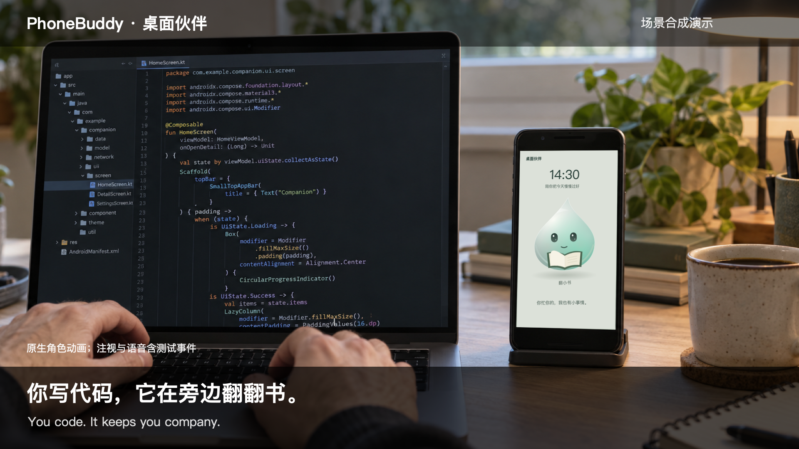

# PhoneBuddy

**Your old phone. Your new companion.**

Turn a spare Android phone into a little companion for your desk. No dedicated companion hardware required. While you code or study, it reads, sketches, plays with bubbles, or stacks little stones. When you look over, it responds with its eyes and a small greeting. When you speak, a waveform and incremental text make its listening state visible.

[中文](README.md) · [Download preview APK](https://github.com/wangshande/PhoneBuddy/releases) · [24-second feature video](docs/media/phonebuddy-features.mp4) · [Contribute](CONTRIBUTING.md)



This is an early, usable open-source preview. Character interactions, Chinese speech recognition, and basic task commands can run on-device. Open-ended conversation requires a configured model service. Background transcription is opt-in; continuous 24-hour battery life and reliability have not been benchmarked.

## A new place for a spare phone

- **While you work:** your companion keeps itself busy rather than falling asleep whenever you look away.
- **When you take a break:** face and head-orientation cues trigger a visible response.
- **When a thought comes up:** ask in Chinese to remember a task, review the transcript, and confirm it before adding it.
- **When you want a record of the day:** manually enable transcription and browse a rolling, local 24-hour text timeline.

You can simply enjoy the companion without enabling continuous recording.

## See it in context

[Desk scenario and media notes](docs/media/README.md) show the intended experience beside a computer. The [feature video](docs/media/phonebuddy-features.mp4) uses native character frames and test UI captures. Concept compositing and scripted gaze/speech events are disclosed; these are not end-to-end recognition accuracy demonstrations.

## Five companions


Moon Orb is calm; Cloud is soft and relaxed; Little Ghost is shy; Star Sprout celebrates small wins; Waterdrop is curious. Each uses native Android Canvas drawing, expressive eyes, body deformation, and coordinated props.

## Try it

1. Download `PhoneBuddy-preview.apk` from [Releases](https://github.com/wangshande/PhoneBuddy/releases).
2. Open the app, choose a companion, and enter the desk screen.
3. Allow camera and microphone access, then place the phone securely with the front camera facing you.
4. Try the gaze response and a clear Chinese task request. Optional services and all-day settings are available in the companion and speech settings.

The current interface and bundled speech model are Chinese. **Android 8.0+ and ARM64 are required**; 32-bit devices are not supported by this APK. Gaze interaction needs a working front camera and speech needs a microphone. Broad testing across older phones is still pending.

The approximately 42 MB Chinese speech model is bundled in the approximately 68 MB APK and extracted locally on first use. The phone does not need to download a voice model separately.

The debug preview uses `com.deskbuddy.design`, can coexist with the original app, and requires manually entering the desk screen. Automatic launch from charging broadcasts is disabled in this preview.

## What runs where

| Capability | Behavior |
| --- | --- |
| Gaze response | On-device face/head orientation, not precise eye tracking |
| Listening feedback | Real microphone-level waveform and incremental transcription |
| Offline speech | Bundled Vosk Chinese model |
| Tasks | Explicit commands require confirmation; ordinary conversation does not automatically become a task |
| Open-ended conversation | Requires a configured model endpoint; the offline fallback is rule-based |
| Optional external ASR | Configurable HTTPS multipart transcription endpoint, model and key; chunked updates depend on service latency |
| All-day companion | Can remain open after unplugging; respects battery screen timeout |
| Optional transcription | Manually started microphone foreground service with a stop action |
| Rolling memory | Local 24-hour text history, search and deletion; conversation recall is separately enabled |

Companionship and background transcription are separate options. Recording, camera use and keeping the screen lit consume power. Android battery policies or process termination can interrupt long recording sessions.

## Privacy and control

Camera frames are processed locally and are not uploaded. Default Chinese speech recognition runs on-device. Memory stores text, not raw audio files. If you enable external ASR, audio chunks are sent to your configured service. Configured conversation services receive conversation text; optional recall can attach relevant transcript excerpts to recall questions.

You can stop transcription from its notification and clear saved text in the timeline. The service does not silently restart recording after it is stopped by the system.

## Build

Use JDK 17, Gradle 8.7, Android SDK 34 and build-tools 34.0.0. Homebrew is not required.

```sh
git clone https://github.com/wangshande/PhoneBuddy.git
cd PhoneBuddy
# Set JAVA_HOME and ANDROID_HOME for your local JDK / Android SDK.
printf 'sdk.dir=%s\n' "$ANDROID_HOME" > local.properties
./gradlew :app:assembleDebug :app:testDebugUnitTest :app:lintDebug
```

The APK is written to `app/build/outputs/apk/debug/app-debug.apk`. The voice model is included in the repository. The wrapper pins the official Gradle checksum; the first build still needs network access for Gradle/Maven dependencies. Your local debug signature may differ from the published APK; manage your own signing keys for upgrades and never commit them.

Application sources are in `app/src/main/java/com/deskbuddy/`. `PetView` draws the companion, `DeskActivity` runs the desk UI, Vosk/Cloud backends handle speech, and `MemoryService`/`MemoryStore` implement optional transcription and retention.

## Validation and limitations

14 JVM tests and 20 device checks passed; Android lint reported zero errors. Device checks include camera frames, real microphone capture, one prerecorded Chinese recognition sample, UI events, layouts, tasks, unplug behavior, and memory retention. Some checks inject controlled gaze/speech events and are not accuracy benchmarks.

Remaining work includes older-device coverage, long-session power/reliability measurements, real placement/noise testing, and real external-ASR provider validation. See [test documentation](docs/TESTING.md) and [contribution notes](CONTRIBUTING.md). Report your device and reproducible steps through [Issues](https://github.com/wangshande/PhoneBuddy/issues).

## License

Application source: [MIT](LICENSE). The unmodified Vosk small Chinese 0.22 model retains its Apache-2.0 license and notices in `app/src/main/assets/voice/`. Other dependencies retain their respective licenses.
