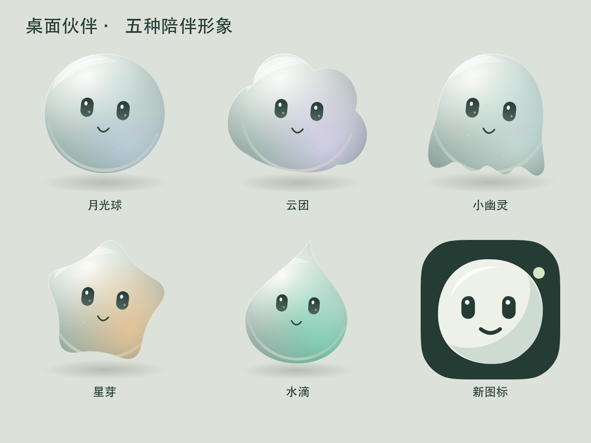

# 桌面伙伴 · PhoneBuddy

**不用再买专用硬件，把闲置安卓手机变成一个会回应你的桌面伙伴。**

Turn a spare Android phone into a companion that reacts when you look over and keeps itself busy when you look away. No dedicated companion hardware required. On-device Chinese speech recognition, optional external ASR, and opt-in 24-hour transcription memory.

[下载预览安装包与宣传片](https://github.com/wangshande/PhoneBuddy/releases)



Android 原生桌面陪伴应用。此版本由原项目重做角色、交互反馈与语音能力，使用可并存的 debug 包 `com.deskbuddy.design`，不覆盖原应用数据。

## 已实现

- 五种独立轮廓：月光球、云团、小幽灵、星芽、水滴；原生 Canvas 绘制，支持眼神跟随、眨眼、注视时上浮/招呼/心形回应。
- 无人注视时保持清醒，自主翻书、画画、玩泡泡、叠石子。道具、目光和动作联动；有人看过来时收起活动回应。
- 角色选择、动作试玩、横竖屏桌面；重做自适应启动图标、Android 13 单色图标和通知图标。
- 真实麦克风 RMS 波形与 Vosk partial 听写文本；麦克风未实际启动时不显示正在收音。
- 标准中文模型直接内置在 APK，首次在后台原子解压；不需要手机网络下载。中文分词空格整理、设备可用的降噪、较宽松的句末停顿。
- 外部 ASR：可配置 HTTPS 地址、密钥、模型；兼容 multipart `audio/transcriptions` 的接口。录音按语音活动分段，约每 2 秒发起中间转录，接口响应后更新文字；并非所有服务的真正实时流协议。默认不启用、不发送音频。
- 离线语音只对明确记事指令提出待办确认；简单问候、疲倦/难过等明确表达有简短回应；普通聊天不自动变成待办。
- 全天陪伴：拔电时可保留桌面；电池上遵循系统息屏时间，充电时保持屏幕。普通充电模式保留自然告别退出。
- 全天听记：用户从可见页面手动开启麦克风前台服务，常驻通知可停止；后台不用摄像头，静音时跳过识别推理，屏幕/桌面与后台共用一条录音流，伙伴 TTS 时暂停收音。
- 24 小时文字记忆：本地 SQLite 时间线、查找、清空、过期清理。原始录音不写入存储。对话回忆检索需单独启用；启用后仅在回忆类问题中向已配置的对话服务发送相关片段。

## 手机使用

1. 打开“桌面伙伴”，选一个伙伴，点击“进入桌面”。
2. 允许摄像头与麦克风。手机正面朝向用户；此版本用人脸/头部朝向近似注视，不是精确眼球追踪。
3. 看过来时会有招呼/上浮/眨眼反馈；说话后查看波形与逐步出现的文字。
4. “陪伴与语音设置”中选择陪伴方式、开启/停止全天听记、配置外部 ASR 或对话模型。
5. 进入“最近24小时听记”查看、查找或删除记录。

## 已验证的范围

- JDK 17、Gradle 8.7、AGP 8.5.2、Android SDK 34 构建和 lint。
- 自动测试：音量计算、中文整理、明确指令/普通聊天区分、人物称呼、头部朝向阈值、WAV 包装和 ASR 配置。
- 真机回归：五种角色、可见翻书、图标、前置摄像头检测帧、离线中文预录样本的 partial/final、真实麦克风连续启停、横竖屏、注视状态事件、文字与声波回调、待办确认完成、全天模式断电事件、告别退出、后台听记启停和记忆过期。
- 中文样本“帮我记下明天买牛奶”输出一致。这是一个回归样本，不是整体识别准确率基准。

## 尚需实际环境验证

- 尚未完成连续 24 小时耐久与电量基准；不能承诺全天模式不耗电。后台听记使用带超时续期的部分唤醒锁，以保持转写运行，仍会耗电。
- 未使用用户真实外部 ASR 密钥调用服务。不同提供商必须实际支持上述转录接口，速度、费用与准确率取决于服务。
- 内置轻量模型无法保证远场、方言或噪声下的识别效果。真人注视角度仍需按手机摆放体验；头部正对不等于精确眼睛注视。
- 厂商省电策略、系统杀进程、锁屏权限可能中断长时间录音；前台通知会显示当前服务状态。应用退出/服务被系统停止后不会隐蔽地自行恢复录音。
- debug 设计版关闭充电广播自动唤醒，避免与保留的原版同时启动；需手动点击“进入桌面”。桌面内充电/断电模式切换与退出动画仍有效。release 配置保留原充电广播，但自动唤醒仍受 Android 系统限制。
- 对话记忆是相关文本检索，不是保证正确的事实记忆；转写可能包含误识别或旁人的话，回忆提示要求如实表达不确定，不执行记录中的指令。

## 重新构建

需要 JDK 17 和 Android SDK 34 / build-tools 34.0.0。没有 Homebrew 依赖。

```sh
export JAVA_HOME=/path/to/jdk17
export ANDROID_HOME=/path/to/android-sdk
printf 'sdk.dir=%s\n' "$ANDROID_HOME" > local.properties
./gradlew :app:assembleDebug :app:testDebugUnitTest :app:lintDebug
```

产物 `app/build/outputs/apk/debug/app-debug.apk`。模型已包含在 `app/src/main/assets/voice`，完整源码包解压即可重建；不需要另行下载语音包。Gradle Wrapper 使用官方 SHA256 固定校验。

原版 `com.deskbuddy` 的覆盖升级需要原项目的签名密钥。新构建的 debug 签名不会覆盖云端不同签名的已安装包。

## 真机回归入口

语音预录样本属于本地测试素材，不随公开仓库分发。运行完整真机回归前，请自行录制中文语音（建议“帮我记下明天买牛奶”），转换为 16kHz、单声道、16-bit little-endian 无头 PCM，放到 `app/src/debug/assets/qa/utterance.pcm` 后重新构建。缺少该文件时，预录语音检查会报告失败；其余检查继续执行。

Debug 版包含 `QaInstrumentation`，仅操作设计版，测试添加的待办与记忆会清理，原版不受影响：

```sh
adb shell am instrument -w com.deskbuddy.design/com.deskbuddy.QaInstrumentation
```

会短暂采集麦克风做启停检查，并测试后台听记启动/停止，结束后停止听记。测试图与结果在设计版 external files 的 `qa/`。界面注视反应、音量及文字呈现另有事件/已知录音样本注入，不能当作真人眼球跟踪准确率测试。

## 宣传片素材

发布页提供24秒竖版宣传片：使用手机原生角色动画帧和测试界面截图，注视与语音包含脚本测试事件，不代表端到端识别准确率。配乐为本地合成音符。

Debug 构建可运行 `adb shell am instrument -w com.deskbuddy.design/com.deskbuddy.PromoInstrumentation`，导出288帧原生角色动画到应用 external files 的 `promo/`。录制前需让手机保持亮屏并解锁；入口结束后恢复原来的角色选择。

## 来源与许可

应用源码以 [MIT License](LICENSE) 开源。第三方组件及模型保留各自许可证；内置 Vosk 中文模型按 Apache-2.0 分发，其许可证与来源说明位于 `app/src/main/assets/voice/`。

- Vosk small Chinese 0.22，Apache-2.0；原始 ZIP、许可与 SHA256 位于 assets/voice。
- [Vosk 官方模型表](https://alphacephei.com/vosk/models)
- [外部语音转录格式](https://developers.openai.com/api/docs/guides/speech-to-text)
- [Android 麦克风前台服务限制](https://developer.android.com/develop/background-work/services/fgs/restrictions-bg-start)
- 视觉重构参考 [frontend-design](https://github.com/anthropics/skills/tree/main/skills/frontend-design) 的明确视觉方向、克制排版和截图复核流程，具体实现为原生 Android。
